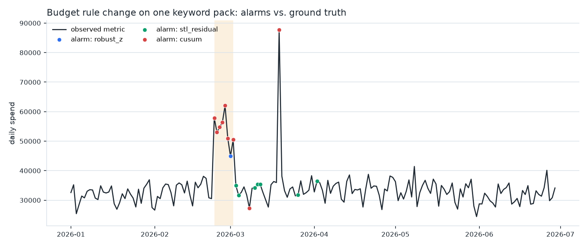
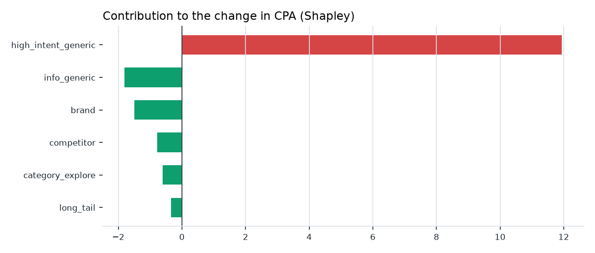

# metric-anomaly-radar

**Anomaly detection and dimension-level attribution for advertising metrics — built so the detector can be evaluated, not just demoed.**

[](https://github.com/KrisZeng-Space777/metric-anomaly-radar/actions/workflows/ci.yml)


Most "ad anomaly detection" repos plot a line, circle a spike by eye, and stop there. This one does the part that is actually hard:

1. **A known answer key.** A documented synthetic delivery process (keyword pack × placement × hour block) with six injected events across four anomaly families, so precision/recall are measurable rather than asserted.
2. **Three detectors under one leakage-free protocol.** Rolling robust z-score, one-step-ahead STL residuals, and tabular CUSUM — each may only look backwards, and every threshold was tuned on a separate development seed before being reported on a held-out seed.
3. **Attribution that adds up.** CPA = spend / conversions is a ratio, so segment deltas do not sum to the total change. Shapley values on the *change* do, and they attribute interaction explicitly instead of dumping it on the last segment iterated.

```
synthetic delivery  ->  inject 4 anomaly families  ->  detectors (z / STL / CUSUM)
        |                                                      |
        |                                                      v
        +--> answer key  ------------------------->  point + event scoring
                                                               |
                                                               v
                                        Shapley attribution -> "which slice moved it"
```

## Results

Benchmark: 180 days, 10 monitored series (`total`, 6 keyword packs, 3 placements), 6 injected events, 3-day detection tolerance. Thresholds selected on a development seed (`seed=1`, see `scripts/tune_detectors.py`) and reported on a held-out seed (`seed=7`).

| detector | precision | recall | f1 | event recall | MTTD (days) | false alarms /100 series-days | runtime |
|---|---|---|---|---|---|---|---|
| `robust_z` | **0.970** | 0.525 | **0.681** | 4/6 | 0.00 | **0.06** | 0.03 s |
| `cusum` | 0.551 | 0.443 | 0.491 | 3/6 | 0.33 | 1.29 | 0.06 s |
| `stl_residual` | 0.405 | 0.279 | 0.330 | 3/6 | 0.00 | 1.35 | 7.5 s |

What the table actually says:

- **`robust_z` wins, and it is not close.** A trailing same-weekday median plus MAD gives the best precision (0.97) with almost no false alarms. Its point recall is capped by design: once a level shift has lasted 2–3 days it *is* the new baseline, so a point-wise score stops firing — the classic masking effect.
- **`cusum` is the only detector that catches the placement drop the other two miss entirely** (d+1), because it accumulates deviations instead of reacting to one day. The price is the noisiest alarm stream (1.29 false alarms per 100 series-days).
- **`stl_residual` is the honest negative result.** It costs ~250× the compute of `robust_z` and scores worse here. With only ~12 weekly cycles of history and weekday-heteroskedastic noise, STL's estimated seasonal component is simply less stable than a 4-week same-weekday median. It stays in the repo because a benchmark that only contains winners is not a benchmark.
- **What nobody catches: the slow ramp and the variance change.** The 14-day trend event moves +3.8%/day ≈ 0.34σ/day, below CUSUM's 0.5σ allowance, so the accumulated statistic never crosses the threshold within the tolerance window; the mean-preserving variance event is invisible to all three by construction. Both are named limitations, not hidden ones — the obvious next steps are a slope-based test and volatility-aware calibration.



*One keyword pack whose budget rule changed (shaded). The unshaded spike on 19 Mar is a site-wide tracking outage — legitimately visible in every series, which is why events carry a scope, and why scoring counts it once, not ten times.*



*Shapley decomposition of the CPA change during the budget change. Contributions sum to the total change by construction; negative bars are slices whose mix or efficiency moved the other way.*

## Quickstart

```bash
python -m venv .venv && source .venv/bin/activate    # Windows: .venv\Scripts\activate
pip install -e ".[dev]"

mar demo                  # ~10s: data -> detection -> attribution -> figures
pytest                    # 30 tests
```

`mar demo` writes everything to `data/` and `results/`:

```
data/ad_metrics.csv         12,960 rows, full grain
data/events.json            the answer key
results/benchmark.md        the table above
results/attribution.csv     Shapley contributions
results/figures/*.png       figures used in this README
```

Individual steps:

```bash
mar synth --days 180 --out data
mar benchmark --data data/ad_metrics.csv --events data/events.json
mar attribute --data data/ad_metrics.csv --dim keyword_pack --metric cpa --window 28
```

## Using it on your own data

The detectors and the attribution are data-agnostic; only the generator is ad-specific.

```python
import pandas as pd
from mar.detectors import RobustZDetector

series = pd.read_csv("your_daily_metric.csv", index_col=0, parse_dates=True)["spend"]
flags = RobustZDetector(window=28, threshold=4.0).detect(series)
print(series[flags])
```

```python
from mar.attribution import shapley_change, explain

table = shapley_change(baseline_df, current_df, by="keyword_pack", metric="cpa")
print(explain(baseline_df, current_df, by="keyword_pack", metric="cpa"))
# cpa changed +6.92; the top 3 keyword_pack slices carry 90% of the total absolute
# attribution: high_intent_generic +11.9 (+173%), info_generic -1.8 (-26%), ...
```

## Repo layout

```
src/mar/
  synth.py         data generating process (documented, seeded)
  anomalies.py     injection + answer key + monitored-series builder
  detectors/       robust_z, stl_residual, cusum (shared protocol)
  evaluation.py    point-wise and event-wise scoring
  attribution.py   exact Shapley on metric change
  benchmark.py     orchestration + markdown rendering
  plotting.py      README figures
  cli.py           mar demo / synth / benchmark / attribute
scripts/
  tune_detectors.py  hyper-parameter sweep on the development seed
tests/             30 tests: schema, reproducibility, detector behaviour, scoring edge cases
docs/method.md     every modelling and protocol decision, plus limitations
```

## Design decisions worth arguing about

- **MAD, not standard deviation.** Spikes inflate σ until masking hides them.
- **Weekday median before scoring.** Cheapest seasonal adjustment that survives missing days — and, per the table, a better one than STL on short noisy histories.
- **One-step-ahead STL.** Fitting on a window that includes today and reading today's residual off the edge leaks the anomaly into the trend component and distorts the scale; the detector predicts today from a fit that ends yesterday.
- **Calibrate on forecast errors, not in-sample residuals.** STL's components fit the noise too, so in-sample residuals collapse the robust scale and everything looks anomalous.
- **Event-level scoring next to point-level.** A detector that fires only on day one of an 8-day event looks fine point-wise and is useless operationally.
- **Events carry a scope.** A tracking outage that fires all ten series is one incident; counting it as ten misses (or ten false positives) would mis-rank every detector.
- **Shapley for ratios.** Naive segment-delta decomposition of a ratio metric does not reconstruct the total; Shapley does, and it handles interaction explicitly.

Full reasoning and caveats: [`docs/method.md`](docs/method.md).

## Limitations

- All data is synthetic. The numbers describe detector behaviour **on this generator**, not on any real account.
- Univariate per series; cross-series correlation is not exploited.
- Fixed thresholds, no per-series calibration against an alarm budget.
- The `variance` family is intentionally hard and remains largely undetected; the 14-day ramp is missed within the 3-day tolerance by all three detectors.

No employer or client data is used, referenced, or reproduced anywhere in this repository.

## License

MIT
